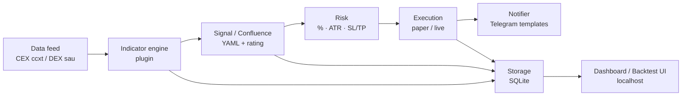

# Đề xuất kiến trúc — Hệ thống giao dịch (Trading System)

Tài liệu này để **Tomas duyệt trước khi viết code**. Chưa có logic giao dịch; chỉ thiết kế và lộ trình.

---

## 1. Mục tiêu ngắn gọn

Xây hệ thống **theo dõi nhiều khung thời gian** (multi-TF: M15, H1, H4, D1), **BTC làm cặp chính**, lấy tín hiệu khi nhiều chỉ báo **cùng đồng thuận** (confluence), gắn **điểm đánh giá rủi ro / độ tin cậy** cho mỗi tín hiệu, quản lý rủi ro rõ ràng, chạy **paper** (giả lập) rồi mới **live**, báo qua Telegram (nhiều kênh, tên hiển thị tùy chỉnh) và xem trên dashboard localhost — kể cả UI backtest kiểu panel thống kê + hộp lệnh LONG/SHORT.

---

## 2. Vì sao chia thành nhiều lớp (layers)?

Giống nhà máy: mỗi trạm làm một việc. Đổi sàn (Bybit → sàn khác) không phải viết lại chỉ báo; đổi chiến lược không đụng lệnh thật.

| Lớp | Việc làm | Ví dụ đời thường |
|-----|----------|------------------|
| **Data feed** | Lấy nến / giá từ sàn (adapter) | Camera theo dõi thị trường |
| **Indicator engine** | Tính EMA, RSI, MACD… | Nhân viên đọc biểu đồ |
| **Signal / Confluence** | Ghép điều kiện AND + điểm số + **rating** | Họp bàn: đủ phiếu mới vào lệnh |
| **Risk** | % vốn, ATR sizing, SL/TP | Bảo vệ tài khoản |
| **Execution** | Gửi lệnh paper/live | Thủ quỹ đặt lệnh |
| **Notifier** | Telegram (nhiều kênh / TF / method) | Chuông báo |
| **Storage** | SQLite (sau: Postgres) | Sổ ghi chép |
| **Dashboard / Backtest UI** | Xem trạng thái + thống kê PnL trên localhost | Bảng điều khiển |

### Luồng dữ liệu (mermaid)



**Modular (mô-đun):** mỗi phần một thư mục + giao diện rõ. Chỉ báo mới = thêm plugin; sàn mới = thêm adapter — không sửa toàn bộ hệ thống.

---

## 3. Exchange adapters (CEX + DEX)

### CEX (sàn tập trung) — Phase 1 trở đi

- Dùng thư viện **ccxt** để nói chuyện với API sàn.
- **Bybit trước**, sau đó có thể thêm Binance và sàn CEX khác qua cùng lớp adapter (cùng interface: lấy nến, giá, đặt lệnh…).
- **Không hard-code** tên sàn hay API key trong code.
- Bật/tắt và chọn sàn qua:
  - **`.env`**: API key / secret (bí mật, không commit).
  - **YAML config**: `exchange` (vd. `bybit`), `market_type` (`spot` / `perp`), cờ `enabled: true/false`, nguồn chart/data.

### DEX (sàn phi tập trung) — sau, không cùng ccxt

- DEX **không** dùng cùng đường ccxt như CEX (API / ví / on-chain khác hẳn).
- Sẽ có **adapter riêng** (ví dụ Uniswap / DEX khác) khi cần — cùng interface “data feed / execution” nhưng implementation khác.
- Phase 1 chỉ thiết kế **chỗ cắm adapter** (extensibility); **chưa code DEX**.

### Toggle & chart / data source

| Cấu hình | Ví dụ | Ý nghĩa |
|----------|--------|---------|
| `exchange` | `bybit` | Sàn đang dùng |
| `market_type` | `perp` | Spot hay hợp đồng |
| `enabled` | `true` | Bật adapter này |
| `data_source` / chart | `exchange` (mặc định) | Nến từ API sàn; sau có thể gắn nguồn khác cho UI |

**Tóm lại cho Tomas:** CEX (Bybit → Binance…) **có trong kiến trúc ngay**. DEX **để sau**, adapter riêng. Đổi sàn / khóa API bằng config + `.env`, không sửa cứng trong code.

---

## 4. TradingView — hai hướng (không “nhét Python vào TV”)

TradingView **không cho** bơm bot Python của mình vào biểu đồ TV bất kỳ. Vì vậy kiến trúc tách **hai hướng rõ ràng**:

| Hướng | Là gì? | Khi nào? |
|-------|--------|----------|
| **(A) Pine Script (tùy chọn)** | Viết lại logic chỉ báo / chiến lược bằng Pine để backtest / nhìn trên TV giống screenshot (panel thống kê, hộp lệnh). | Phase phụ / add-on **sau** — **không chặn Phase 1**. |
| **(B) Dashboard / backtest Python của mình** | UI localhost mô phỏng UX: vốn, winrate, phí, hộp LONG/SHORT với SL / TP / Qty, PnL. | Phase **5** (engine backtest) + Phase **6** (UI dashboard). |

**Cầu nối nếu cần:** Telegram alerts hoặc **webhook** từ TV → hệ thống của mình (nhận tin, không inject code vào TV).

**Tóm lại:** Muốn nhìn “như TradingView + panel tiếng Việt” → chủ yếu làm trên **dashboard Python**. Pine chỉ là tùy chọn để xem trên TV thật; không bắt buộc để chạy bot.

---

## 5. Điểm đánh giá tín hiệu (`rating`)

Mỗi **tín hiệu / lệnh** lưu một trường **`rating`** (ví dụ thang **1–10**): độ tin cậy hoặc mức rủi ro theo quy tắc confluence / risk (giống kiểu Telegram “Rủi ro: 7/10” + thanh trực quan).

| Việc | Chi tiết | Phase sở hữu |
|------|----------|--------------|
| Tính & gắn rating | Từ luật confluence / risk trong config | **Phase 3** (tín hiệu) |
| Lưu DB | Cột `rating` trên signal/order | Phase 3 (+ schema từ Phase 1 mở rộng) |
| Hiện Telegram | Dòng “Rủi ro / Độ tin cậy: X/10” (+ thanh nếu template cho phép) | **Phase 6** (notifier) |
| Analytics sau | Trung bình rating, lọc theo kênh/TF/method | Sau Phase 6 (báo cáo / dashboard) |

**Tóm lại:** Có trong thiết kế — lưu mỗi lệnh, hiện Telegram, sau này phân tích rủi ro trung bình.

---

## 6. Notifier — template & tên hiển thị tùy chỉnh

Mỗi tin Telegram (và notifier khác sau này) **phải có** trong nội dung / metadata:

- **Channel** (kênh / chat đích)
- **Timeframe** (M15, H1, H4, D1…)
- **Strategy / method `display_name`** — tên đẹp do bạn đặt trong YAML (vd. `"Confluence BTC H1"`), không bắt buộc trùng tên file kỹ thuật
- **Nhãn chỉ báo** từ config (vd. `"EMA 34/89"`, `"RSI filter"`) — tùy chỉnh được

**Multi-channel / multi-TF / multi-method:** routing trong YAML — ví dụ method A + TF H1 → chat này; method B → chat khác. Bật/tắt từng route bằng cờ config.

| Việc | Phase |
|------|--------|
| Skeleton notify (gửi test) | Phase 1 tối thiểu / hoàn thiện Phase 6 |
| Template đầy đủ + `display_name` + multi-route | **Phase 6** |

---

## 7. Cấu trúc thư mục dự kiến

```
trading-system/
├── README.md                 # Hướng dẫn chạy (cập nhật mỗi phase)
├── .env.example              # Mẫu bí mật (không commit key thật)
├── configs/
│   ├── watchlist.yaml        # BTC… + TF: M15, H1, H4, D1
│   ├── exchanges.yaml        # exchange, market_type, enabled, data_source
│   ├── strategies/           # Chiến lược YAML/JSON + display_name, indicator labels
│   ├── notify.yaml           # Multi-channel routing + templates
│   └── risk.yaml             # % risk, ngưỡng score, rating rules, kill switch
├── src/
│   ├── data/                 # Feed + exchange adapters (CEX ccxt; DEX sau)
│   ├── indicators/           # Plugin chỉ báo (cùng interface)
│   ├── signals/              # Confluence AND + score + rating
│   ├── risk/                 # Sizing, SL/TP, giới hạn
│   ├── execution/            # Paper + live
│   ├── notify/               # Telegram templates
│   ├── storage/              # SQLite → sau Postgres
│   ├── backtest/             # Multi-TF, không nhìn trước
│   └── dashboard/            # Localhost UI (stats + trade callouts)
├── optional/                 # (sau) Pine Script port — không chặn Phase 1
├── tests/                    # Test theo từng phase
├── logs/                     # Nhật ký (không commit dữ liệu nhạy cảm)
└── docs/
    └── architecture-roadmap.md
```

---

## 8. Lộ trình 6 phase (mỗi phase: code + test + README)

| Phase | Giao gì | Test trọng tâm | Ghi chú mở rộng từ yêu cầu mới |
|-------|---------|----------------|--------------------------------|
| **1 — Nền tảng** | Cấu trúc repo, `.env`, logging, SQLite tối thiểu, **adapter CEX Bybit (ccxt)** đọc dữ liệu, paper skeleton; chỗ cắm adapter (DEX sau) | Kết nối / mock feed; ghi log; schema DB | Toggle exchange qua config + `.env`; **chưa** DEX, **chưa** Pine |
| **2 — Chỉ báo** | Interface plugin + EMA34/89, RSI, MACD, BB, VWAP, ATR, Volume, cấu trúc thị trường, S/R, nến/mẫu; tùy chọn funding/OI/liq | Đúng công thức trên dữ liệu cố định; không phụ thuộc sàn | — |
| **3 — Tín hiệu** | Watchlist multi-TF; strategy YAML/JSON; confluence **AND bắt buộc** + **score ≥ threshold**; **`rating` 1–10** trên mỗi tín hiệu | Config mẫu → có/không tín hiệu + rating đúng kỳ vọng | **Rating thuộc Phase 3** |
| **4 — Risk + Execution** | % risk, ATR sizing, partial TP + runner; spot: “hold losers” chỉ khi **thủ công**; **perp bắt buộc SL**; limits + kill switch; paper rồi live | Sizing đúng; từ chối lệnh thiếu SL (perp); kill switch dừng | Rating đi kèm order vào DB |
| **5 — Backtest** | Multi-TF **không look-ahead**; phí / slippage / funding; metrics; Optuna + walk-forward; nền cho UI stats | Không rò rỉ tương lai; báo cáo metric ổn định | Track **(B)** — số liệu cho panel vốn / winrate / phí |
| **6 — Notify + Dashboard** | Telegram templates (channel, TF, `display_name`, indicator labels, rating); multi-channel routing; dashboard localhost (stats + hộp LONG/SHORT SL/TP/Qty) | Gửi tin test đúng template; UI hiện trạng thái / lệnh / PnL | **Notifier templates → Phase 6**; UI giống screenshot |

**Add-on sau (không chặn Phase 1–6):**

- **Pine Script (track A)** — port tùy chọn lên TradingView.
- **DEX adapter** — phase sau hoặc khi Tomas ưu tiên; Phase 1 chỉ để sẵn interface.

Sau mỗi phase: bạn duyệt kết quả → mới sang phase sau.

---

## 9. Tech stack đề xuất

**Chọn chính: Python**

| Lý do | Chi tiết |
|-------|----------|
| Hệ sinh thái quant | `ccxt`, pandas, TA libraries sẵn |
| Backtest / tối ưu | Optuna, walk-forward dễ viết |
| Đọc được | YAML/JSON config; phù hợp người mới |
| Dashboard | FastAPI hoặc Streamlit trên localhost |

**Thư viện chính (dự kiến):** Python 3.11+ · ccxt · pydantic/settings · SQLite → Postgres · python-telegram-bot · pytest · Optuna.

**Thay thế chỉ khi rõ ràng hơn:** TypeScript/Node (nếu team web-only) — kém hơn cho backtest/quant; **không khuyến nghị** lúc này.

**Bảo mật & dữ liệu:** secrets trong `.env`; logging đầy đủ; SQLite trước, Postgres khi cần nhiều agent / máy.

---

## 10. Quy tắc rủi ro (đã chốt trong thiết kế)

- Rủi ro theo **% tài khoản**; kích thước lệnh theo **ATR**.
- **Partial TP** (chốt một phần) + **runner** (giữ phần còn lại theo xu hướng).
- **“Hold losers”** (giữ lệnh lỗ): **chỉ spot** và **chỉ khi bạn xác nhận thủ công** — không tự động.
- **Perp (hợp đồng tương lai):** **bắt buộc Stop Loss**; thiếu SL → hệ thống **không gửi lệnh**.
- **Limits** (giới hạn lệnh/ngày, lỗ tối đa…) + **kill switch** (dừng khẩn cấp).
- Mỗi tín hiệu/lệnh có **`rating`** để theo dõi rủi ro / độ tin cậy theo thời gian.

---

## 11. Confluence & chỉ báo ban đầu

**Confluence:** mọi điều kiện đánh dấu **required** phải đúng (**AND**), **và** tổng điểm ≥ ngưỡng trong config. Từ đó (và luật risk) suy ra **`rating`**.

**Chỉ báo / module khởi đầu**

- Bắt buộc hướng: EMA 34/89, RSI, MACD, Bollinger Bands, VWAP, ATR, Volume, market structure, Support/Resistance, nến & pattern.
- Tùy chọn (perp): funding, open interest (OI), liquidations.

Tất cả implement qua **plugin cùng interface** (cùng cách gọi `compute(...)`). Tên hiển thị trên Telegram lấy từ config (`display_name` / nhãn chỉ báo), không hard-code trong notifier.

---

## 12. Câu hỏi cần bạn trả lời trước khi code

Trả lời ngắn trong chat là đủ; agent sẽ cập nhật `project-context.md`.

1. **Ưu tiên chính: Spot hay Perp?** (có thể hỗ trợ cả hai; cần biết cái nào làm trước.)
2. **Vốn paper** khởi điểm bao nhiêu USDT? (ví dụ 1.000 / 5.000 / 10.000.)
3. **Timezone** hiển thị & lịch giao dịch: `Asia/Ho_Chi_Minh` hay UTC?
4. **Bybit API** (key + secret, quyền đọc/ghi phù hợp) đã tạo chưa? Paper có dùng testnet không?
5. **Telegram bot token** + chat ID đã có chưa? Dự kiến **một** hay **nhiều** kênh từ đầu?
6. **Ngưỡng score confluence** ban đầu bạn muốn khoảng bao nhiêu? (ví dụ 60/100 — có thể đổi sau trong YAML.)
7. **Đòn bẩy (leverage) tối đa** nếu làm perp trước? (ví dụ 2x–5x khi mới.)
8. **`rating`:** bạn muốn thanh theo kiểu “Rủi ro cao = số lớn” hay “Độ tin cậy cao = số lớn”? (cùng thang 1–10, chỉ khác cách đặt tên trên UI.)
9. **Pine Script (TV):** có muốn làm sau Phase 6 không, hay chỉ cần dashboard Python là đủ?

---

## 13. Bước tiếp theo sau khi duyệt

1. Bạn trả lời mục 12 và xác nhận “OK, làm Phase 1”.
2. Agent triển khai **chỉ Phase 1** (test + README) — **chưa** DEX, **chưa** Pine.
3. Bạn xem kết quả → duyệt Phase 2 → …

*Tài liệu song song trong repo git: `docs/architecture-roadmap.md`.*
